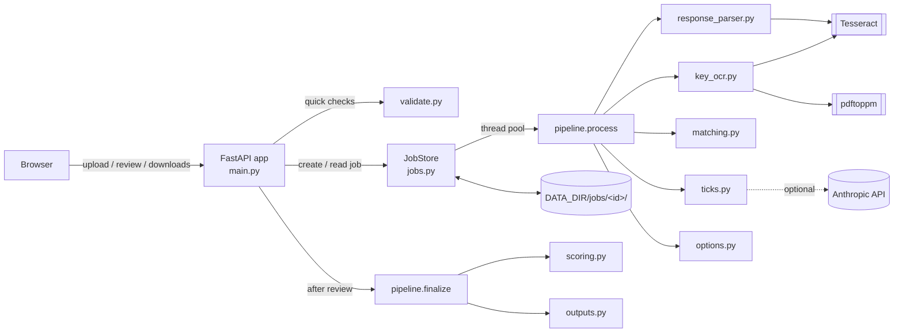
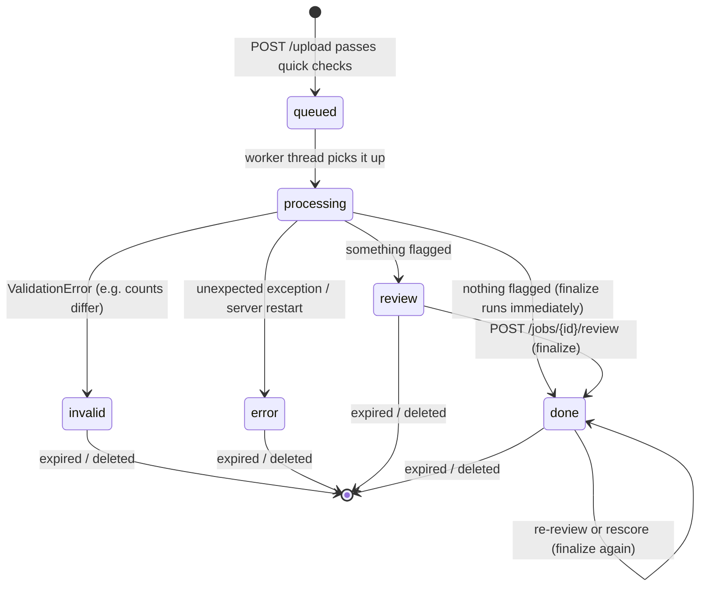

# Architecture

This document covers how the service is put together: the components, how a job moves through them, where data
lives and the main data structures. How each processing stage works internally is in [PIPELINE.md](PIPELINE.md),
and tick detection is in [TICK_DETECTION.md](TICK_DETECTION.md).

## Overview



- A single **FastAPI** process serves server-rendered Jinja2 pages, with a little vanilla JavaScript for status
  polling and live swaps on the review page.
- Heavy work runs in a **thread pool inside the same process** (`JOB_WORKERS` threads, default 1). Within a job, OCR
  is parallelised across `OCR_THREADS` Tesseract subprocesses.
- **No database.** Each job is a folder on disk holding its status (`job.json`), its working state (`state.json`)
  and its files. Restarting the process loses only the jobs that were mid-processing.
- **External tools:** Tesseract 5 (OCR) and Poppler's `pdftoppm` (rendering). Both are installed in the Docker image.

## Module map

| Module | Responsibility | Depends on |
|---|---|---|
| `main.py` | HTTP routes, form parsing, template rendering, file streaming | everything below |
| `config.py` | `Settings` dataclass read from environment variables | — |
| `jobs.py` | `JobStore`: create, read, update and delete job folders; run jobs on the thread pool; expiry cleanup | `pipeline` |
| `validate.py` | User-facing checks raising `ValidationError(message)` | `response_parser` |
| `pipeline.py` | Runs every stage (`process`), review overrides (`apply_review`), scoring and outputs (`finalize`) | all stage modules |
| `models.py` | Dataclasses shared between stages | — |
| `response_parser.py` | Response-sheet format detection and parsing, question crops, response OCR | pdfplumber, Tesseract |
| `key_ocr.py` | Key rendering, OCR, footer filtering, segmentation into questions, key crops | pdftoppm, Tesseract |
| `matching.py` | Text normalisation, TF-IDF similarity, Hungarian assignment, match flags | scikit-learn, SciPy |
| `ticks.py` | Option-label location, ink measurement, tick decision, optional AI fallback | OpenCV, anthropic |
| `options.py` | Option-order comparison and letter translation | `matching.normalise` |
| `scoring.py` | Classifies each question and totals marks | — |
| `outputs.py` | `evaluation.csv`, `results.json`, reordered response PDF | pypdf, reportlab |

The stage modules do not know about jobs or HTTP: they take file paths and data, and return data. That keeps each
of them testable on its own (see [DEVELOPMENT.md](DEVELOPMENT.md)).

## Job lifecycle



1. **Upload** (`POST /upload`, synchronous). The two files are streamed into a new job folder, stopping as soon as
   either goes over `MAX_FILE_MB`. Then the cheap checks run: real PDF, not encrypted, size and page limits, and a
   recognised response-sheet format (only the first few pages are looked at). On failure the folder is deleted and
   the form is shown again with the message. On success the job is queued and the browser goes to `/jobs/{id}`.
2. **Processing** (background thread, `pipeline.process`). It runs all the stages and saves `state.json`. Checks
   that need the full parse or the OCR (numbering gaps, question-count mismatch, no questions found in the key) raise
   `ValidationError` here, and the job ends as `invalid` with that message.
3. **Review.** If `pipeline.needs_review(state)` is true, the job waits in `review`. Otherwise `finalize` runs
   straight away and the job becomes `done`.
4. **Finalize** (`pipeline.finalize`) applies the review overrides, scores and writes `out/`. It runs again after
   every review submission and every rescore. The outputs are always regenerated from `state.json`, so they never go
   stale.
5. **Expiry.** A daemon thread calls `JobStore.cleanup()` every 10 minutes, and once at startup. It deletes job
   folders older than `RETENTION_HOURS`, except jobs still queued or processing. **Delete now** calls
   `JobStore.delete` immediately.

At startup, jobs left `queued` or `processing` by a previous process are marked `error` ("interrupted by a server
restart"), because nothing will ever finish them.

## Job folder

```
DATA_DIR/jobs/<job id>/
├── job.json                 status, progress, options (see below)
├── key.pdf                  uploaded answer key
├── response.pdf             uploaded response sheet
├── pages/                   key page renders (page-NNN.jpg). Deleted when processing ends
├── crops/
│   ├── resp_NNN.png         response question image, by response Q.n (200 dpi)
│   └── key_NNN.jpg          answer-key question, by key position (stitched across pages if needed)
├── state.json               everything review/results need (see below)
├── similarity.npy           key × response text-similarity matrix (float64)
└── out/
    ├── evaluation.csv
    ├── results.json
    └── reordered_response.pdf
```

The job ID is `secrets.token_urlsafe(16)` (128 bits). It is the only access control, so treat a job URL like a
password. Every route checks the ID against a strict character set before touching the filesystem.

Writes to `job.json` and `state.json` go to a temporary file followed by an atomic rename, so a reader never sees a
half-written file. `job.json` updates are additionally serialised by a lock.

### `job.json`

| Field | Type | Meaning |
|---|---|---|
| `id` | str | Job ID |
| `created`, `started`, `finished` | float | Unix timestamps (`created` drives expiry) |
| `status` | str | `queued`, `processing`, `review`, `done`, `invalid` or `error` |
| `stage` | str | Human-readable current stage, shown on the progress page |
| `progress` | float | 0–1 |
| `message` | str | User-facing error message for `invalid` / `error` |
| `options.scoring` | object | `ScoringConfig` (see [PIPELINE.md](PIPELINE.md#8-scoring)) |
| `options.use_ai` | bool | AI fallback requested **and** available |

### `state.json`

Written by `pipeline.process`. The review only updates the `review` section.

```jsonc
{
  "response": {
    "subject": "Statistics, Mathematics and Economics",   // from the response sheet header
    "page_sizes": [[595.3, 841.9], ...],                  // points
    "questions": [ResponseQuestion, ...]                  // sorted by qnum
  },
  "key": {
    "n_pages": 118,
    "questions": [KeyQuestion, ...],                      // in key order; index = position (1-based)
    "margin_mismatches": [22]                             // key indices whose margin number disagreed
  },
  "matches": [MatchPair, ...],                            // one per key question, in key order
  "option_checks": {"1": OptionCheck, ...},               // keyed by key index (string)
  "warnings": ["..."],                                    // shown on review/results pages
  "ai_used": false,
  "review": {
    "matches": {"10": 55, "20": 31},   // key index -> response Q.n, only where different from the automatic match
    "answers": {"38": "A"},            // key index -> letter, only where different from the detected answer
    "submitted": true
  }
}
```

The current mapping is always the automatic `matches` with `review.matches` laid on top
(`pipeline.current_mapping`). The current key answer is `review.answers[k]` if set, otherwise the detected tick if it
was not uncertain, otherwise none (`pipeline.current_key_answer`). Because the overrides are stored separately, the
automatic results are never lost, and the review page can show "set by you (detected B)".

## Data model (`models.py`)

| Dataclass | Fields | Notes |
|---|---|---|
| `BlockPart` | `page`, `top`, `bottom` | A slice of a response-sheet page in **PDF points from the page top**. A question block is a list of these (one per page it spans). |
| `ResponseQuestion` | `qnum`, `question_id`, `status`, `chosen`, `parts`, `image_page`, `image_bbox`, `crop_path`, `ocr_text` | `chosen` is `"A"`–`"E"` or `None` (not answered). `image_bbox` is `(x0, top, x1, bottom)` in points. |
| `KeyPart` | `page`, `y0`, `y1` | A slice of a rendered key page in **pixels at `RENDER_DPI`**, full page width. |
| `KeyQuestion` | `index`, `parts`, `text`, `margin_number`, `crop_path`, `tick` | `index` is the 1-based position in the key, which is the key's question number. `margin_number` is the number actually read in the margin, if any. |
| `TickResult` | `answer`, `uncertain`, `method`, `ink`, `labels_found`, `ai_answer`, `note` | `method` is `image` or `ai` (`manual` comes from the review). `labels_found` maps letters to `[page, x0, y0, x1, y1]` in pixels. `ink` holds the three measurements per letter. |
| `MatchPair` | `key_index`, `resp_qnum`, `score`, `margin`, `flagged`, `reasons` | One per key question. |

`OptionCheck` (in `options.py`) has `status` (`same`, `reordered`, `suspect` or `unchecked`), `mapping` (key letter
to response letter, only when reordered) and `detail`.

Two coordinate systems are in use. Response-sheet positions are in **PDF points**, because they come from the text
layer and are reused to clip vector content. Answer-key positions are in **pixels of the render**, because the key
exists only as an image.

## Concurrency

- One `ThreadPoolExecutor` with `JOB_WORKERS` threads runs jobs. Each job uses `OCR_THREADS` more threads, each
  driving a Tesseract or pdftoppm subprocess, so peak CPU use is about `JOB_WORKERS × OCR_THREADS` processes.
  `OMP_THREAD_LIMIT=1` stops each Tesseract process from also spawning its own threads.
- Web requests read `job.json` and `state.json` without locks. Atomic renames make this safe.
- The review and rescore requests run `finalize` synchronously in the request (a few seconds, mostly building the
  PDF). They are only allowed once processing has finished, so they never race the worker for the same job.
- Peak memory is a few hundred MB. Tick detection keeps at most a handful of page images in memory at a time.

## Extending to other formats

Format-specific code is kept behind small seams so other exam layouts can be added later. See
[DEVELOPMENT.md](DEVELOPMENT.md#adding-a-new-exam-format).
